<h3><code>xCodeWraith@alpha-node ~ $ ./contributions.sh</code></h3>

  

<h3><code>xCodeWraith@alpha-node ~ $ whoami</code></h3>

<table border="0" cellpadding="0" cellspacing="0">
  <tr>
    <td valign="top"></td>
    <td width="20"></td>
    <td valign="top"></td>
  </tr>
</table>

  

<h3><code>xCodeWraith@alpha-node ~ $ ./featured_weapons.sh</code></h3>

<table border="0" cellpadding="0" cellspacing="0">
  <tr>
    <td valign="top">
      
    </td>
    <td width="10"></td>
    <td valign="top">
      
    </td>
    <td width="10"></td>
    <td valign="top">
      
    </td>
  </tr>
</table>

  

  <a href="https://x.com/xCodeWraith"><b>𝕏 / DEV (@xCodeWraith)</b></a> &nbsp;&nbsp;•&nbsp;&nbsp;
  <a href="https://github.com/xCodeWraith"><b>github.com/xCodeWraith</b></a> &nbsp;&nbsp;•&nbsp;&nbsp;
  <code>"Insider news is good, insider tools are better."</code>

